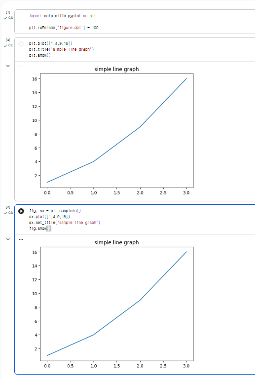
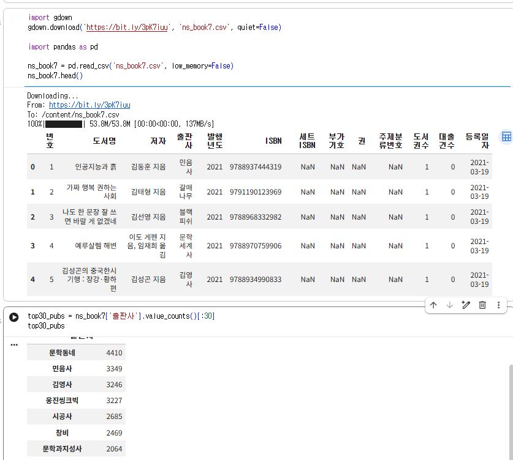
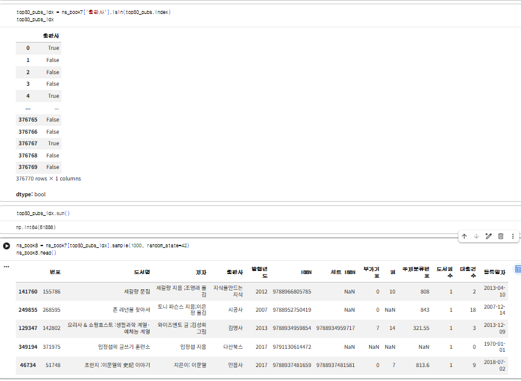
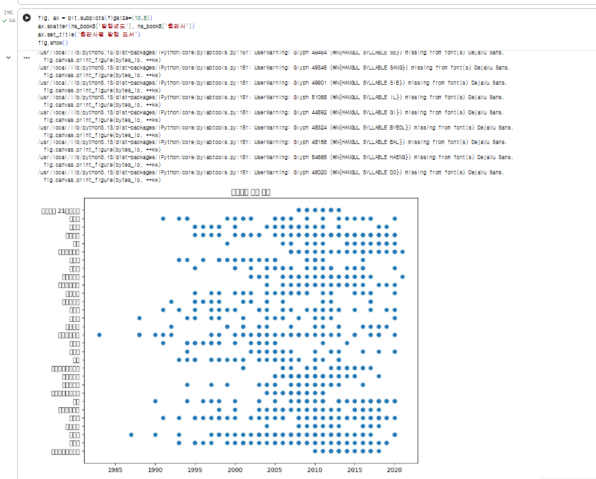

# 데이터분석 6주차 정규과제

📌데이터분석 정규과제는 매주 정해진 분량의 『*혼자 공부하는 데이터 분석 with 파이썬*』 을 읽고 학습하는 것입니다. 이번 주는 아래의 **DataAnalysis_6th_TIL**에 나열된 분량을 읽고 공부하시면 됩니다.

아래의 문제를 풀어보며 학습 내용을 점검하세요. 문제를 해결하는 과정에서 개념을 스스로 정리하고, 필요한 경우 제시된 강의를 참고하여 보완하는 것이 좋습니다.

<!-- 강의 링크는 아래와 같습니다.
https://www.youtube.com/watch?v=XD65UhBMOiI&list=PLVsNizTWUw7FGzSRCkQrPEEe-ljVXgS7k&index=12
https://www.youtube.com/watch?v=NTQ5NXelOfw&list=PLVsNizTWUw7FGzSRCkQrPEEe-ljVXgS7k&index=13
-->


## DataAnalysis_6th_TIL

### 6장 복잡한 데이터 표현하기
#### 01. 객체지향 API로 그래프 꾸미기
#### 02. 맷플롯립의 고급 기능 배우기


## Study Schedule

| 주차  | 공부 범위     | 완료 여부 |
| ----- | ------------- | --------- |
| 1주차 | p.24~81    | ✅         |
| 2주차 | p.84~151   | ✅         |
| 3주차 | p.154~219  | ✅         |
| 4주차 | p.222~279 | ✅         |
| 5주차 | p.282~325 | ✅         |
| 6주차 | p.328~379 | ✅         |
| 7주차 | p.382~430 | 🍽️         |

<br>

<!-- 여기까진 그대로 둬 주세요-->


# 1️⃣ 개념 정리 

## 01. 객체지향 API로 그래프 꾸미기

- pyplot 방식은 `plt.plot()`처럼 함수를 바로 쓰는 방식이고, 객체지향 API는 `fig, ax = plt.subplots()`로 객체를 만들고 `ax.plot()`처럼 메서드를 쓰는 방식임
  - 복잡한 그래프나 서브플롯이 여러 개일 때는 객체지향 API가 편함
- 기본 폰트는 한글이 깨져서 `plt.rc('font', family='NanumBarunGothic')`처럼 나눔 폰트로 바꿔줘야 함
- `scatter()`의 매개변수
  - `s`는 마커 크기, `c`는 마커 색, `alpha`는 투명도
  - `edgecolor`, `linewidths`는 마커 테두리 색과 두께
- 컬러맵은 값에 따라 색을 다르게 표현함. 기본은 viridis이고 `cmap='jet'`로 바꿀 수 있음
- `fig.colorbar()`로 색이 어떤 값을 뜻하는지 보여주는 컬러 막대를 추가함

## 02. 맷플롯립의 고급 기능 배우기

- `plot()`을 여러 번 호출하면 선 그래프 여러 개를 겹쳐 그릴 수 있음
  - `label`을 넣고 `ax.legend()`를 호출하면 범례가 생김
- 스택 영역 그래프는 `ax.stackplot()`으로 그림
  - 데이터는 `pivot_table()`로 연도를 열로 바꿔서 준비함
- 스택 막대 그래프는 `bar()`의 `bottom`을 쓰거나 `cumsum()`으로 값을 누적해서 그림
- 원 그래프는 `ax.pie()`로 그림
  - `autopct`로 비율을 표시하고, `explode`로 조각을 강조함
  - 크기를 한눈에 비교하기 어려운 게 단점
- `plt.subplots(2, 2)`로 여러 그래프를 한 피겨에 그리고, `axes[0, 1]`처럼 위치를 지정함
- 판다스로도 그릴 수 있음
  - 스택 영역 그래프는 `df.plot.area()`
  - 스택 막대 그래프는 `df.plot.bar(stacked=True)`


# 2️⃣ 수행 인증






<br>
<br>

# 3️⃣ 확인 문제

## 문제 1.

> **🧚Q. 이번 주차에는 확인문제 대신 그래프 그리기 실습을 진행합니다.
4주차에서 사용했던 캐글 데이터셋을 활용하여, 다양한 요소를 포함한 복잡한 그래프를 직접 작성해주세요.**

```
https://colab.research.google.com/drive/1YFrpl04o-KFOUBJ26mxQkwcoyMjaG9vY?usp=sharing
```


### 🎉 수고하셨습니다.
