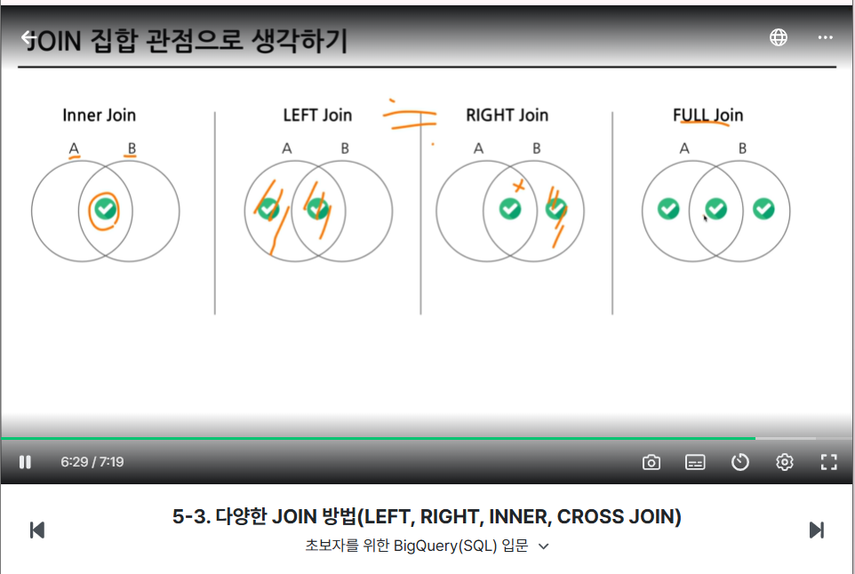
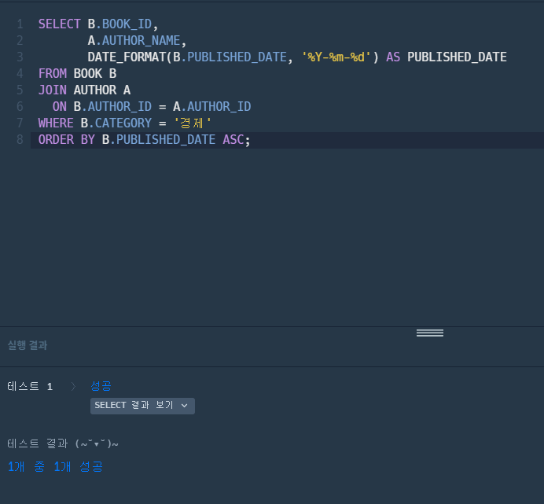
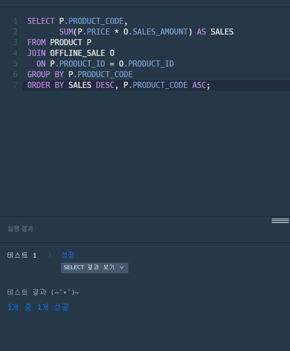
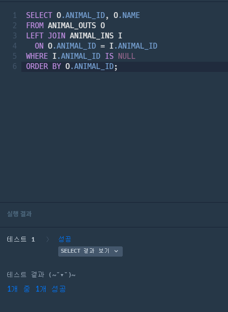
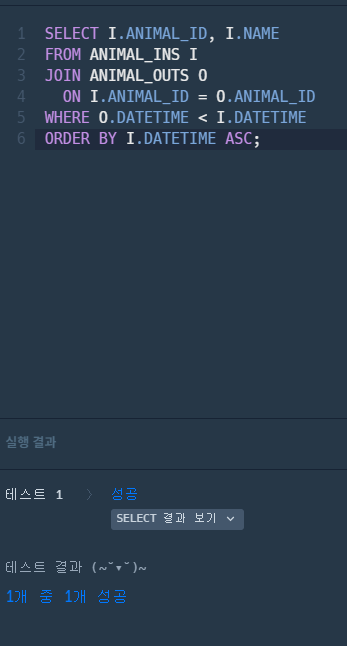

# 📘 SQL_BASIC 6주차 정규 과제

SQL_BASIC 정규 과제는 매주 정해진 분량의 `초보자를 위한 BigQuery(SQL) 입문` 강의를 듣고, 핵심 개념을 정리한 뒤 간단한 SQL 문제를 직접 풀어보는 방식으로 진행합니다.

이번 주는 SQL 입문 과정의 핵심 고비인 `JOIN`을 학습합니다.

JOIN은 여러 테이블을 연결해서 분석 질문에 답하기 위해 반드시 필요한 개념입니다. 이번 주 과제에서는 정답 코드뿐 아니라 **어떤 테이블을 어떤 키로 연결했는지**를 꼭 기록해주세요.

완성된 과제는 Github에 업로드하고, 링크를 스프레드시트 'SQL' 시트에 입력해 제출해주세요.

**👀 수행 인증란은 필수입니다.**

---

## 📚 SQL_BASIC_6th_TIL

### 섹션 6. 다량의 자료를 연결 : JOIN

### 5-2. JOIN 이해하기

### 5-3. 다양한 JOIN 방법

### 5-4. JOIN 쿼리 작성하기

### 5-5. JOIN을 처음 공부할 때 헷갈리는 부분

---

## ✨ 선택 강의

- 5-6. JOIN 연습문제: JOIN 문제를 더 연습하고 싶을 때 선택 수강

---

## 🏁 전체 강의 수강 계획

| 주차 | 필수 강의 범위 | 선택 강의 | 완료 여부 |
| --- | --- | --- | --- |
| 1주차 | 1-1 ~ 2-1 | 1 | ✅ |
| 2주차 | 2-2 ~ 2-3 | 2-4 | ✅ |
| 3주차 | 2-5, 2-7 ~ 2-8 | 2-6 | ✅ |
| 4주차 | 3-2 ~ 4-3 | 3-4 | ✅ |
| 5주차 | 4-4 ~ 4-6 | 4-5, 4-7 | ✅ |
| 6주차 | 5-2 ~ 5-5 | 5-6 | ✅ |
| 7주차 | 필수 강의 없음 | 6-2, 6-3, 6-4, 6-5 | 🍽️ |

---

<br>

<!-- 여기까진 그대로 둬 주세요-->

---

# 1️⃣ 개념 정리

아래 키워드 중 중요하다고 생각한 개념을 2개 이상 골라 짧게 정리해주세요. 3개보다 더 많이 정리하고 싶다면 자유롭게 항목을 추가해도 좋습니다.

이번 주 키워드:
- JOIN
- INNER JOIN
- LEFT JOIN
- JOIN key
- alias
- NULL
- 다중 JOIN

## 01.

```
개념 이름: JOIN
개념 설명: 서로 다른 데이터 테이블을 연결하는 것
예시 쿼리: SELECT 학생.이름, 성적.점수
FROM 학생
JOIN 성적
  ON 학생.학번 = 성적.학번;
→ 학생 테이블(학번, 이름)과 성적 테이블(학번, 점수)을 학번으로 연결해서 학생 이름 옆에 점수를 붙이기
```

## 02.

```
개념 이름: LEFT JOIN
개념 설명: 왼쪽 테이블 기준으로 연결하는 것
예시 쿼리: SELECT 학생.이름, 성적.점수
FROM 학생
LEFT JOIN 성적
  ON 학생.학번 = 성적.학번;
→ 학생 테이블(왼쪽)의 모든 학생을 다 보여주고 성적이 없는 학생은 점수 칸이 NULL로 나옴
```

## (선택) 03.

```
개념 이름:
개념 설명:
헷갈린 점:
```

---

# 2️⃣ 수행 인증란

아래 중 하나 이상을 첨부해주세요.


---

# 3️⃣ 확인 문제

프로그래머스는 로그인이 필요하므로, 로그인 후 문제 풀이를 진행해주세요.

## 🧩 문제 1

문제 링크: [조건에 맞는 도서와 저자 리스트 출력하기](https://school.programmers.co.kr/learn/courses/30/lessons/144854)

풀이 과정:

```
- 사용한 테이블: BOOK(도서 정보), AUTHOR(저자 정보)
- JOIN key: AUTHOR_ID (BOOK.AUTHOR_ID = AUTHOR.AUTHOR_ID)
- 날짜를 출력한 형식: YYYY-MM-DD (DATE_FORMAT(PUBLISHED_DATE, '%Y-%m-%d'))
```


## 🧩 문제 2

문제 링크: [상품 별 오프라인 매출 구하기](https://school.programmers.co.kr/learn/courses/30/lessons/131533)

풀이 과정:

```
- 연결한 테이블: PRODUCT(상품 정보), OFFLINE_SALE(오프라인 판매 정보)
- JOIN key: PRODUCT_ID (PRODUCT.PRODUCT_ID = OFFLINE_SALE.PRODUCT_ID)
- 집계한 값: 상품코드별 매출액 합계 SUM(PRICE * SALES_AMOUNT)
```


## 🧩 문제 3

문제 링크: [없어진 기록 찾기](https://school.programmers.co.kr/learn/courses/30/lessons/59042)

풀이 과정:

```
- 기준이 되는 왼쪽 테이블: ANIMAL_OUTS(입양 보낸 기록)
- LEFT JOIN이 필요한 이유: 입양 기록은 있는데 보호소에 들어온 기록이 없는 동물을 찾아야 해서, ANIMAL_OUTS의 모든 행을 남긴 채 ANIMAL_INS와 연결해야 하기 때문 (일반 JOIN을 쓰면 짝이 없는 동물은 결과에서 빠져버림)
- NULL이 발생하는 경우: ANIMAL_OUTS의 ANIMAL_ID가 ANIMAL_INS에 없을 때, ANIMAL_INS 쪽 컬럼(I.ANIMAL_ID 등)이 NULL이 됨 → 이 행들이 바로 유실된 기록
```


## 🧩 문제 4

문제 링크: [있었는데요 없었습니다](https://school.programmers.co.kr/learn/courses/30/lessons/59043)

풀이 과정:

```
- 사용한 테이블: ANIMAL_INS(보호소에 들어온 동물), ANIMAL_OUTS(입양 보낸 동물)
- JOIN key: ANIMAL_ID (ANIMAL_INS.ANIMAL_ID = ANIMAL_OUTS.ANIMAL_ID)
- 비교한 날짜 컬럼: ANIMAL_OUTS.DATETIME(입양일) < ANIMAL_INS.DATETIME(보호 시작일)
- 정렬 기준: ANIMAL_INS.DATETIME(보호 시작일) 오름차순 (빠른 순)
```


---

# 4️⃣ 참고 자료

JOIN 개념이 헷갈린다면 아래 자료를 함께 참고해도 좋습니다.

1. https://data-marketing-bk.tistory.com/entry/SQL-JOIN-%ED%95%9C-%EB%B0%A9%EC%97%90-%EC%A0%95%EB%A6%AC-%EA%B0%9C%EB%85%90%EB%B6%80%ED%84%B0-%EC%BD%94%EB%93%9C%EA%B9%8C%EC%A7%80-%EC%9D%B4%EA%B2%83%EB%A7%8C-%EB%B3%B4%EC%9E%90
2. https://velog.io/@wijoonwu/JOIN

---

# 5️⃣ 이번 주 회고

```
1. INNER JOIN과 LEFT JOIN의 차이를 어떻게 이해했는지:
INNER JOIN은 두 테이블에 모두 짝이 있는 행만 남기는 것이고, LEFT JOIN은 왼쪽 테이블의 행을 전부 남기고 오른쪽에 짝이 없으면 NULL로 채우는 것이라고 이해했다. 그래서 양쪽에 다 있는 데이터를 볼 때는 INNER JOIN을, 한쪽에만 있는 데이터까지 찾아야 할 때는 LEFT JOIN을 쓴다. 예를 들어 '없어진 기록 찾기' 문제에서는 입양 기록(ANIMAL_OUTS)을 기준으로 LEFT JOIN한 뒤 ANIMAL_INS 쪽이 NULL인 행만 골라서 들어온 기록이 없는 동물을 찾을 수 있었다.

2. JOIN 문제를 풀 때 가장 먼저 확인해야 할 것:
두 테이블을 이어 줄 공통 컬럼(JOIN key)이 무엇인지 그리고 어떤 테이블을 기준으로 삼아야 하는지를 가장 먼저 확인해야 한다. key를 잘못 잡으면 엉뚱한 행끼리 연결되고 기준 테이블을 잘못 고르면 필요한 데이터가 결과에서 빠질 수 있기 때문이다. 또 두 테이블에 이름이 같은 컬럼(DATETIME, NAME 등)이 있는지도 확인해서 테이블 별칭을 붙여 써야 한다.

3. JOIN 결과가 예상과 달랐던 경험이 있다면:
'없어진 기록 찾기' 문제에서 처음에 INNER JOIN을 쓰고 WHERE ... IS NULL 조건을 걸었더니 결과가 하나도 나오지 않았다. INNER JOIN은 짝이 있는 행만 남기기 때문에 NULL인 행이 애초에 생기지 않는다는 것을 알게 되었고 LEFT JOIN으로 바꾸자 원하는 결과가 나왔다. 이 경험을 통해 없는 데이터를 찾을 때는 LEFT JOIN이 필요하다는 점을 확실히 이해했다.
```

수고하셨습니다!


